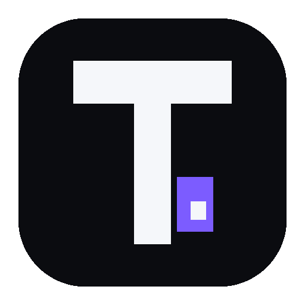

<h1 align="center">Toki · 账号与密钥</h1>

这个邮箱注册过什么？那个手机号绑了哪些 App？API Key 和 Access Token 放在哪？一眼看清。

基于 <a href="https://github.com/Ckxkx/account-atlas">账号星图 Atlas</a> 二次开发，新增网页版 Tokens 密钥管理模块

  
  
  

> **关于 Toki**：本项目是 [Ckxkx/account-atlas](https://github.com/Ckxkx/account-atlas) 的 fork，新增 Tokens 模块，Logo 与图标为 Toki 原创，不沿用上游品牌素材。上游更新可通过 `upstream` remote 同步。
> 原 Atlas 官方安装包只从 [上游 Releases](https://github.com/Ckxkx/account-atlas/releases/latest) 发布，与 Toki 无关。

## Tokens 模块（网页版）
- **分类管理**：AI API / GitHub / 云服务 / 数据库 / 支付 / OAuth / 其他，支持筛选
- **平台预设**：OpenAI、Claude、GitHub、Cloudflare、Supabase、Stripe 等常见平台一键填入
- **打码与复制**：密钥默认 `••••` 打码，点击显示，一键复制不写入日志
- **到期提醒**：记录到期日，临期/已过期高亮显示
- **加密同步**：与原有账号数据一起走 AES-GCM 端到端加密同步（Gitee / GitHub 私有 Gist）
- **导入导出**：JSON 备份包含 `tokens` 字段，兼容原 Atlas 数据格式（旧备份无 tokens 时自动补空）

## 它能做什么
- **卡包**：每个邮箱、手机号都是一张 Wallet 风格的卡，左右翻看，手机号做成 SIM 卡
- **点选添加**：内置 100+ 常用网站和 App（官方图标），多选后再选用哪个邮箱或手机号，同一网站可记多个账号名
- **关系图**：左边身份、右边 App，自动连线，点卡片只看它连着的
- **深色 / 浅色**：从按钮扩散开的圆形切换
- **隐私模式**：号码和账号名一键打码，截图分享也安心
- **加密同步（可选）**：数据用你的同步密码在本地 AES-GCM 加密后，存进你自己的 Gitee（国内直连）或 GitHub 私密 Gist
- 拖动排序、撤销删除、JSON 导入导出、离线可用

## 下载
最新版在 [Releases](https://github.com/Ckxkx/account-atlas/releases/latest)，同一个版本里有两个文件：
- **Atlas.apk**：安卓（Android 8.0+）原生版，下载后直接安装；以后的版本签名相同，覆盖安装，数据保留
- **Atlas.ipa**：iOS 原生版（未签名），用 SideStore / 爱思助手 / Sideloadly 等自签后安装

GitHub 下载慢的话，可以从 huichen.dev/downloads 下载：[Atlas.apk](https://huichen.dev/downloads/Atlas.apk) · [Atlas.ipa](https://huichen.dev/downloads/Atlas.ipa)。只认这两个地方，别处的都不是官方包。

## 不想自签？用网页版装到桌面（PWA）
网页版本身就能“安装”成 App：有桌面图标，全屏打开没有地址栏，断网也能用。

**iPhone / iPad**
1. 用 **Safari** 打开 https://huichen.dev/account-atlas/
2. 点「分享」按钮（方框加向上的箭头；iOS 26 先点右下角「⋯」）
3. 往下滑，选「添加到主屏幕」，再点「添加」

**安卓**
1. 用 Chrome 或 Edge 打开同一个网址
2. 右上角「⋮」→「添加到主屏幕」或「安装应用」

数据存在这台设备的浏览器里，换手机前记得用「加密同步」或「导出」备份。

## 隐私
数据默认只存在你自己的设备上，没有任何服务器。**不记录密码**。开启同步时，云端只有加密后的文件。

## 三个版本
| | 网页版 | iOS 原生版 | 安卓原生版 |
|---|---|---|---|
| 技术 | 纯 HTML/CSS/JS，零依赖 | SwiftUI，iOS 17+ | Kotlin + Jetpack Compose，Android 8.0+ |
| 安装 | 打开网址，Safari「添加到主屏幕」 | 从 Releases 下载 IPA，用 SideStore / 爱思助手 / Sideloadly 等自签安装 | 从 Releases 下载 APK 直接安装 |
| 代码 | 根目录 `index.html` `app.js` `styles.css` | `native/` | `android/` |

三个版本的数据格式相同，可以通过同步或 JSON 互通。

## 自己运行 / 构建
- 网页版：`python3 -m http.server 8080`，打开 `http://localhost:8080`
- 安卓版：`cd android && ./gradlew assembleRelease`（JDK 17 + Android SDK）；没有配置签名密钥（`ATLAS_KEYSTORE`）时会自动用调试密钥签名。启动图标只有一个源文件 `android/icon-src/icon-1024.png`，换图后重新构建即可
- iOS 版：需要 macOS + Xcode，用 `swiftc` 编译 `native/*.swift`，步骤见 `.github/workflows/ios.yml`
- 推送到 `main` 后，GitHub Actions 只做构建检查：`web.yml` 部署网页版，`android.yml` / `ios.yml` 构建 APK 和 IPA（放在 Actions 产物里，不发 Release）。发版只在打版本标签时进行，规则见 [RELEASING.md](RELEASING.md)

二次创作或自己打包发布时，请把 Logo 和应用图标换成你自己的（见[许可](#许可)）。

## 参与
发现 bug、想要新功能，欢迎[提 Issue](https://github.com/Ckxkx/account-atlas/issues)；代码改进欢迎直接提 Pull Request。

## 请我吃包花生米
觉得好用的话，可以用微信扫码赞赏，随意就好。

## Star History
<a href="https://www.star-history.com/#Ckxkx/account-atlas&Date">
  <picture>
    <source media="(prefers-color-scheme: dark)" srcset="https://api.star-history.com/svg?repos=ckxkx/account-atlas&type=Date&theme=dark" />
    <source media="(prefers-color-scheme: light)" srcset="https://api.star-history.com/svg?repos=ckxkx/account-atlas&type=Date" />
    
  </picture>
</a>

## 许可
代码采用 [GPL-3.0](LICENSE)，版权所有 © 2026 Ckxkx（阿chen）。
- ✅ 可以：使用、修改、二次创作、再分发，包括商用
- ⚠️ 条件：分发修改版或衍生作品时，必须同样以 GPL-3.0 开源、公开完整源码，并保留版权和许可声明
- ❌ 例外：项目自己的 Logo 和应用图标（`logo.svg`、`icon.png`、`icon-512.png`、安卓 `android/icon-src/icon-1024.png` 及生成的启动图标、iOS `AppIcon`）不在 GPL 范围内，保留所有权利。二次创作请换成你自己的 Logo 和图标
- `icons/` 下的第三方网站、App 图标归各自所有者

详见 [NOTICE](NOTICE.md)。之前发布的版本沿用发布时附带的许可。
